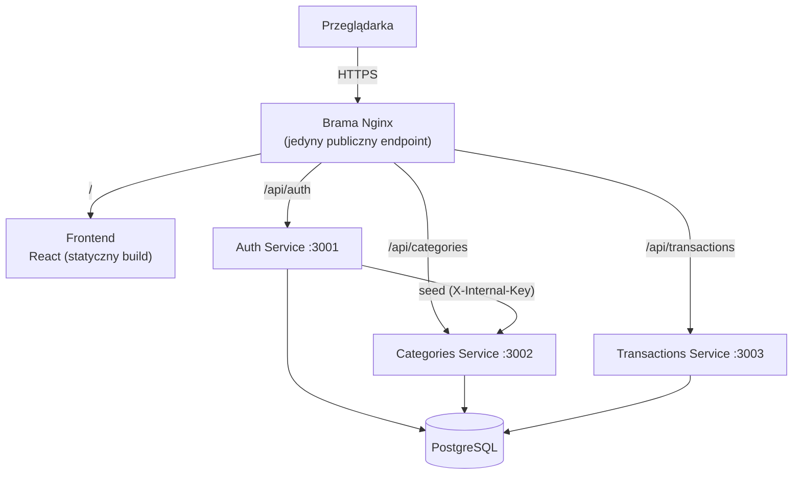

# Personal Finance Tracker

[](https://github.com/Peter-Ka-hub/personal-finance-tracker/actions/workflows/ci.yml)


**🔗 Live demo:** https://ca-gateway.wonderfulsand-f41bf9c3.polandcentral.azurecontainerapps.io
&nbsp;·&nbsp; **📘 API:** [docs/openapi.yaml](docs/openapi.yaml)
&nbsp;·&nbsp; **🛠️ Dziennik problemów:** [docs/PROBLEMY-I-ROZWIAZANIA.md](docs/PROBLEMY-I-ROZWIAZANIA.md)

Aplikacja do śledzenia finansów osobistych: rejestracja/logowanie, kategorie przychodów
i wydatków, dodawanie i przeglądanie transakcji oraz wykresy. Zbudowana jako **architektura
mikroserwisowa** (React + 3 serwisy Node/Express + brama Nginx + PostgreSQL), z pełnym
potokiem **CI/CD** i **Infrastructure as Code** (Bicep), wdrażana na **Azure Container Apps**.

> Projekt portfolio. Punktem wyjścia był monolit CRUD; został przemigrowany do mikrousług,
> uzupełniony o testy, konteneryzację i automatyczne wdrożenie. Pełny dziennik realnych problemów
> napotkanych aż do produkcji znajduje się w [docs/PROBLEMY-I-ROZWIAZANIA.md](docs/PROBLEMY-I-ROZWIAZANIA.md).

## Stack technologiczny

| Warstwa            | Technologie |
|--------------------|-------------|
| Frontend           | React 19, React Router 7, React Query, Recharts, Tailwind CSS, Axios |
| Backend (×3)       | Node.js, Express 5, Sequelize, JWT, bcrypt |
| Brama / routing    | Nginx (reverse proxy) |
| Baza danych        | PostgreSQL 16 |
| Testy              | Jest + Supertest (unit), Node test runner (e2e) |
| Konteneryzacja     | Docker, docker-compose |
| CI/CD              | GitHub Actions |
| Chmura / IaC       | Azure Container Apps, Azure PostgreSQL, Bicep |

## Architektura



- **Brama Nginx** to jedyny publiczny punkt wejścia — frontend i serwisy są wewnętrzne.
  Frontend woła API relatywnie pod `/api`, więc **nie ma problemu z CORS**.
- **Auth** wystawia JWT (HS256); pozostałe serwisy weryfikują token middlewarem.
- Przy rejestracji Auth próbuje utworzyć **10 domyślnych kategorii** przez wywołanie
  wewnętrzne chronione nagłówkiem `X-Internal-Key`.

## API (przez bramę, prefiks `/api`)

| Metoda | Ścieżka                  | Auth        | Opis |
|--------|--------------------------|-------------|------|
| POST   | `/api/auth/register`     | —           | Rejestracja, wydanie JWT i próba inicjalizacji kategorii |
| POST   | `/api/auth/login`        | —           | Logowanie, wydanie JWT i ponowienie oczekującej inicjalizacji |
| GET    | `/api/categories`        | JWT         | Lista kategorii użytkownika |
| POST   | `/api/categories`        | JWT         | Dodanie kategorii |
| DELETE | `/api/categories/:id`    | JWT         | Archiwizacja kategorii |
| POST   | `/api/categories/seed`   | `X-Internal-Key` | Zasiew domyślnych kategorii (wewnętrzny) |
| GET    | `/api/transactions`      | JWT         | Lista transakcji użytkownika |
| POST   | `/api/transactions`      | JWT         | Dodanie transakcji |
| DELETE | `/api/transactions/:id`  | JWT         | Usunięcie transakcji |

Każdy serwis wystawia też `GET /health`.

### Odzyskiwanie po awarii Categories

Auth zapisuje informację o oczekującej inicjalizacji razem z nowym kontem.
Wywołanie Categories ma limit jednej sekundy. Rejestracja zwraca 201 z JWT
również w przypadku awarii Categories. Przy kolejnym udanym logowaniu Auth
ponawia oczekującą inicjalizację. Po powrocie usługi kategorie są widoczne po
tym logowaniu i odczycie listy. Użytkownik, który pozostaje w aktywnej sesji,
może się wylogować i zalogować ponownie, aby uruchomić ponowienie.

Categories zapisuje znacznik i zestaw domyślny w jednej transakcji PostgreSQL.
Znacznik pozostaje po usunięciu kategorii. Konta sprzed zmiany startują bez
oczekującej inicjalizacji, ponieważ pusta lista może wynikać z decyzji
użytkownika. Historyczne przypadki wymagają indywidualnej oceny.

Obie tabele tworzy migracja 002 przed startem usług. Kolejność przejścia
opisuje [instrukcja migracji](db/README.md).

### Kategorie w historii transakcji

Domyślne `GET /api/categories` zwraca aktywne kategorie użytkownika.
`includeArchived=true` dodaje zarchiwizowane kategorie wraz z nazwą i kolorem.
Transakcje bez istniejącej kategorii mają w interfejsie etykietę „Nieznana kategoria”.

Kolumnę `archivedAt` dodaje migracja 003. Dotychczasowe kategorie pozostają
aktywne, a historyczne powiązania zostają zachowane. Kolejność przejścia
opisuje [instrukcja migracji](db/README.md).

Transactions i Categories używają wspólnego PostgreSQL. Zapis transakcji
sprawdza właściciela, typ i stan kategorii, blokując jej wiersz przez `FOR SHARE`
w tej samej transakcji co zapis. Archiwizacja aktualizuje ten sam wiersz.
Operacja, która pierwsza uzyska blokadę wiersza, rozstrzyga kolejność. Zapis,
który czekał na archiwizację, po jej zatwierdzeniu ponownie sprawdza warunek
aktywności. Przy rozdzieleniu ról PostgreSQL `FOR SHARE` wymaga dla Transactions
dostępu do schematu Categories, prawa `SELECT` do używanych kolumn i prawa
`UPDATE` do co najmniej jednej kolumny tabeli kategorii.

## Uruchomienie lokalne

Wymagania: Docker + docker-compose.

```bash
# 1. Skonfiguruj zmienne środowiskowe
cp .env.example .env        # następnie uzupełnij hasła/sekrety

# 2. Zbuduj i uruchom cały stack
docker compose up --build

# 3. Otwórz aplikację
#    http://localhost  (brama na porcie 80)
```

Zmienne środowiskowe (`.env`) — wszystkie sekrety pochodzą stąd, nic nie jest zaszyte w kodzie:

| Zmienna            | Opis |
|--------------------|------|
| `DB_USER` / `DB_PASSWORD` / `DB_NAME` | Dane logowania PostgreSQL |
| `POSTGRES_MIGRATOR_PASSWORD` | Hasło roli uruchamiającej migracje |
| `POSTGRES_AUTH_PASSWORD`, `POSTGRES_CATEGORIES_PASSWORD`, `POSTGRES_TRANSACTIONS_PASSWORD` | Hasła dedykowanych ról usług |
| `JWT_SECRET`       | Sekret do podpisu JWT (min. 32 znaki) |
| `INTERNAL_API_KEY` | Klucz wywołań wewnętrznych (auth → categories) |

Compose czeka na przygotowanie ról i zakończenie migracji przed uruchomieniem
usług. Instrukcje dla istniejącej bazy i startu usług poza Compose są w
[dokumentacji migracji i ról](db/README.md).

## Testy

```bash
# Testy jednostkowe danego serwisu (baza mockowana)
cd services/auth && npm ci && npm test          # auth / categories / transactions

# Testy frontendu
cd frontend && npm ci && npm test -- --watchAll=false

# Testy e2e przez bramę (wymaga uruchomionego docker-compose)
node --test e2e/app.test.mjs
```

Test współbieżności Categories można włączyć, ustawiając
`CATEGORY_TEST_DATABASE_URL` na adres testowego PostgreSQL przed
`npm --prefix services/categories test`. Test tworzy i usuwa własny,
losowo nazwany schemat.

Test blokad na PostgreSQL można włączyć przez `E2E_POSTGRES_URL` wskazujący na
izolowaną bazę używaną przez stos E2E. Wymaga to także zainstalowania zależności
`services/transactions` lokalnie. Test czasowo blokuje tabelę transakcji i zapisuje
rekord ze starszym typem powiązania, więc uruchamiaj go na bazie testowej.

## CI/CD

- [`.github/workflows/ci.yml`](.github/workflows/ci.yml) — przy każdym PR/push: testy jednostkowe
  (matryca 3 serwisów), build + testy frontendu, testy **e2e** na świeżo postawionym docker-compose.
- [`.github/workflows/deploy.yml`](.github/workflows/deploy.yml) — wdrożenie na Azure dopiero po
  zielonych testach. Po zbudowaniu obrazów uruchamia migracje w Azure Container
  Apps Job i stosuje `apps.bicep` dopiero po sukcesie joba. Logowanie do Azure
  odbywa się przez **OIDC**.

## Struktura repozytorium

```
.
├── frontend/            # Aplikacja React (CRA + Tailwind)
├── services/
│   ├── auth/            # Rejestracja, logowanie, wydawanie JWT
│   ├── categories/      # Kategorie + zasiew domyślnych
│   └── transactions/    # CRUD transakcji
├── gateway/             # Brama Nginx (reverse proxy)
├── infra/               # Bicep (base.bicep, apps.bicep, modules/)
├── e2e/                 # Testy end-to-end przez bramę
├── docs/                # Dziennik problemów i rozwiązań
└── docker-compose.yml   # Lokalny stack
```

## Czego ten projekt dowodzi

- Projektowanie i migracja do **architektury mikroserwisowej** z bramą API.
- Bezpieczeństwo: hasła hashowane bcrypt, autoryzacja JWT, walidacja wejścia (Zod), nagłówki
  bezpieczeństwa (Helmet), rate limiting na endpointach auth, sekrety poza kodem, ruch wewnętrzny
  chroniony osobnym kluczem.
- **Pełna automatyzacja**: testy jednostkowe + e2e w CI, IaC w Bicep, wdrożenie na Azure przez OIDC.
- **Debugowanie produkcyjne**: 21 udokumentowanych, realnych problemów (HTTP 426 na bramie,
  globalne limity Azure, wyścigi startowe w CI, OIDC) — zob.
  [docs/PROBLEMY-I-ROZWIAZANIA.md](docs/PROBLEMY-I-ROZWIAZANIA.md).
